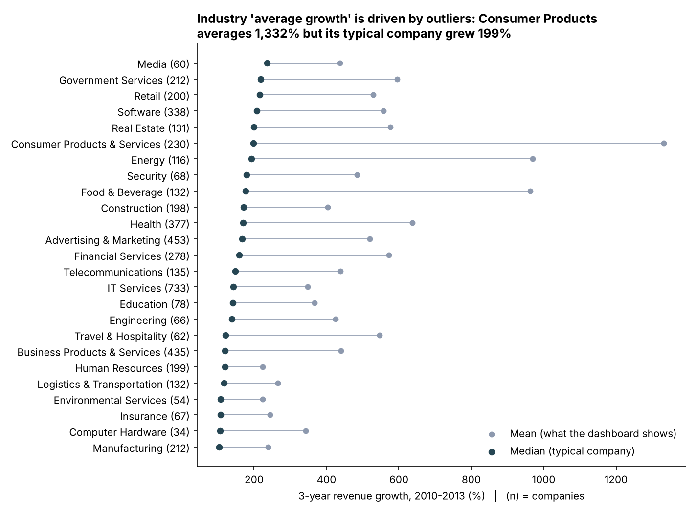
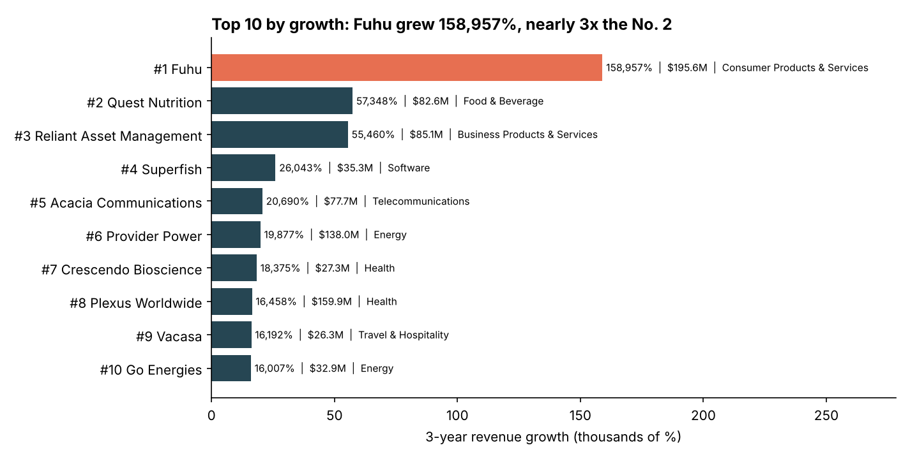
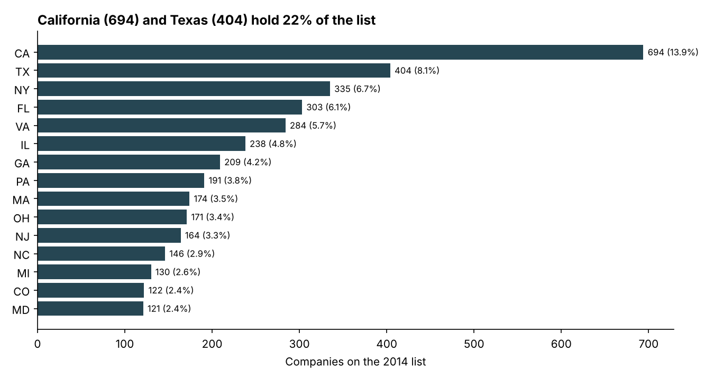

# Inc. 5000 (2014): Growth & Revenue Dashboard

A Tableau dashboard of the 2014 **Inc. 5000**, Inc. magazine's list of the
5,000 fastest-growing private U.S. companies, ranked by 3-year revenue growth from 2010 to 2013.
A reproducible Python companion (`insights.py`) checks the dashboard's numbers and adds the
views the dashboard is missing.


## Key findings

- **5,000 companies with $215.3B of combined 2013 revenue.** The median company had $10.7M of revenue and 50 employees.
- **"Average growth 516%" is misleading.** Growth is extremely skewed: the **median company grew 152%**. Fuhu alone (+158,957%) lifts the mean by 32 points. The minimum to make the list was 42%.
- **Industry rankings flip when using the median.** By average, Consumer Products & Services looks fastest (1,332%), but that comes from Fuhu; its typical company grew 199%. By median, **Media (236%), Government Services (219%) and Retail (215%)** lead.
- **Geography is concentrated.** California (694) and Texas (404) hold 22% of the list. Wyoming has no companies on it.
- **Largest groups:** IT Services (733 companies), Advertising & Marketing (453) and Business Products & Services (435).

**Takeaway for an investor or analyst:** the headline growth rates describe a few
outliers. To compare industries, use the median, and read growth together with company size.

## Companion charts (`insights.py`)





## Dashboard accuracy check

| Dashboard element | Check | Status |
|---|---|---|
| KPI: average growth 516.4 | Matches data (mean). Median is 151.7. | ✅ correct, ⚠️ misleading alone |
| KPI: sum of revenue 215,290,911,811 | Matches data (2013 revenue) | ✅ |
| KPI: 5,000 companies | Matches | ✅ |
| KPI: average workers 209.0 | Matches (median 50) | ✅ |
| Map labels (e.g. CA 694, MN 94, MA 174) | Match company counts by state | ✅ |
| "Average Growth by Industry" bars | Means are skewed by single companies | ⚠️ switch to median |
| "Top 10 Companies by Growth" table | Shows "Abc" placeholders, sorted A–Z, no values | ❌ needs fixing |
| Industry bar charts | Only 7 of 25 industries visible in the image (scroll) | ⚠️ |

### How to fix the dashboard in Tableau

1. **Top 10 table:** drag `Growth` onto *Text* (replacing the "Abc" placeholder), add `Rank` to Rows, sort by `Rank` ascending, and filter `Rank <= 10`.
2. **Average growth KPI and industry chart:** change the aggregation of `Growth` from *Average* to *Median* (right-click → Measure → Median), or show both.
3. **Industry charts:** use *Fit → Entire View* so all 25 industries are visible in the exported image.
4. **Map:** add a legend title that says the colour is revenue and the label is company count.

## Data source and verification

- `Data Set- Inc5000 Company List_2014.csv`: 5,000 rows, scraped from Inc.'s public list
  (`inc.com/inc5000list/json/inc5000_2014.json`, via the import.io tool; the `_input`/`_widgetName`/… columns are scraper metadata).
- Checked against 2014 press coverage: Fuhu was No. 1 with 158,957% growth and $195.6M revenue, and Quest Nutrition, Reliant Asset Management, Superfish and Acacia Communications were Nos. 2–5 with matching growth and revenue. Minnesota's 94 companies also match local coverage.
- Ranks follow growth exactly, apart from differences under 0.01 points (Inc. ranks on unrounded growth).
- `growth` = % revenue growth 2010→2013; `revenue` = 2013 revenue (USD).
- 13 companies report 0 workers, and 58 have no metro area. Both are left as published.
- The data belong to Inc. and remain subject to their terms.

## Files

| File | Description |
|---|---|
| `2014 inc 5000 growth vs Industry.twb` | Tableau workbook |
| `Data Set- Inc5000 Company List_2014.csv` | Source data (unchanged) |
| `INC 5000 2014 Tableau Dashboard.png` | Dashboard snapshot |
| `insights.py` | Reproducible checks + companion charts → `kpi.json`, `industry_summary.csv`, `state_summary.csv` |

### Open the workbook

Download the `.twb` and the CSV into the same folder and open the `.twb`. The workbook was saved
with the data at `C:/Users/ASUS/Downloads`, so if Tableau says the data source is missing, click
**Edit Connection** and select the CSV.

### Run the checks

```bash
pip install -r requirements.txt
python insights.py
```

## License

The workbook, code and documentation are MIT-licensed (see `LICENSE`). The Inc. 5000 data belong to Inc.
