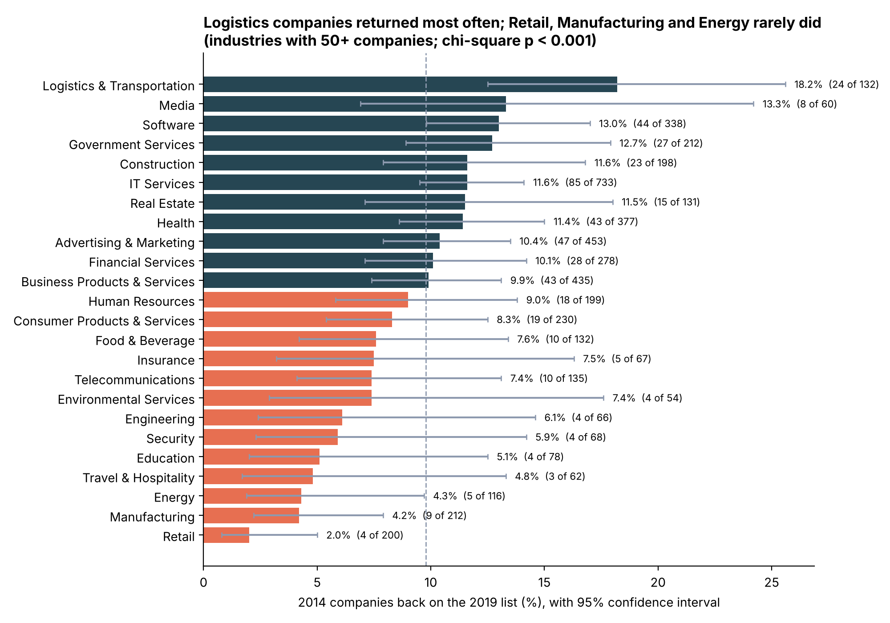
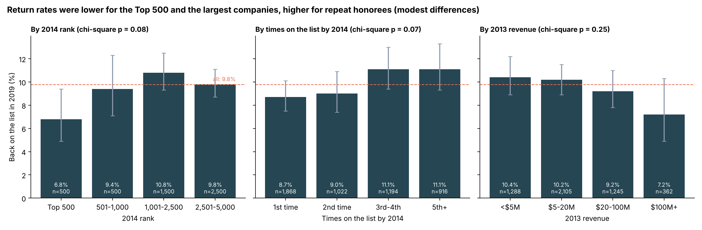
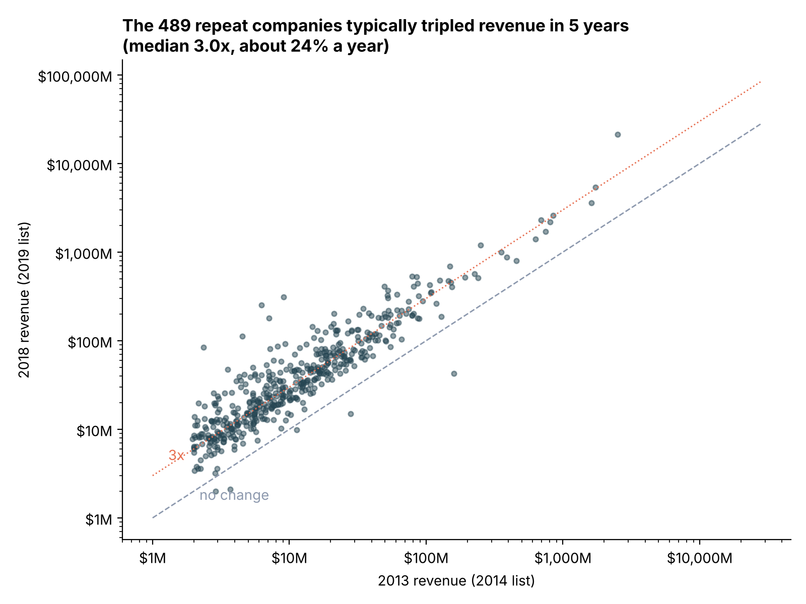
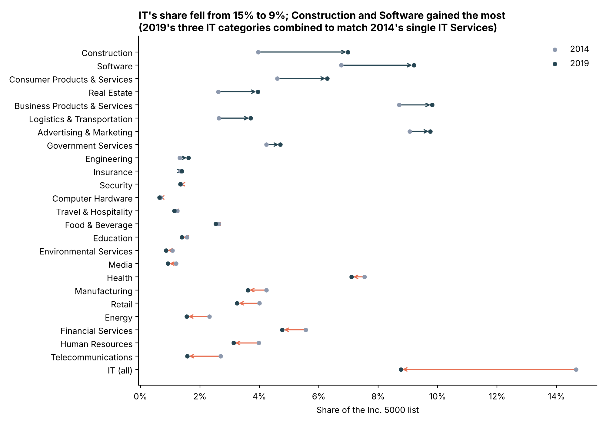
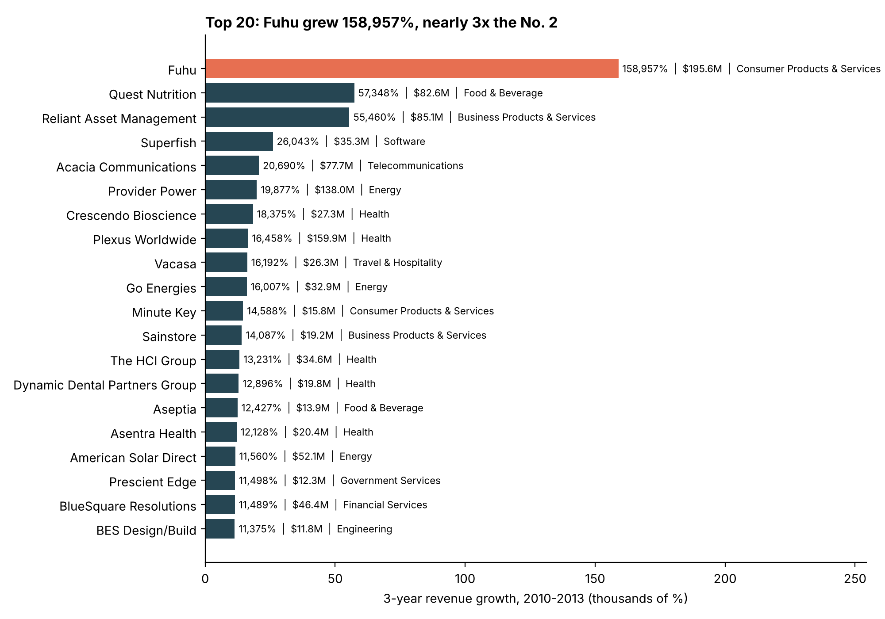
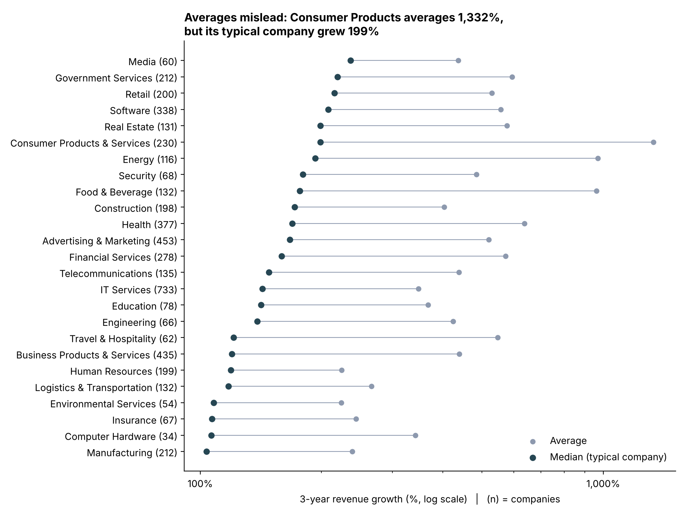
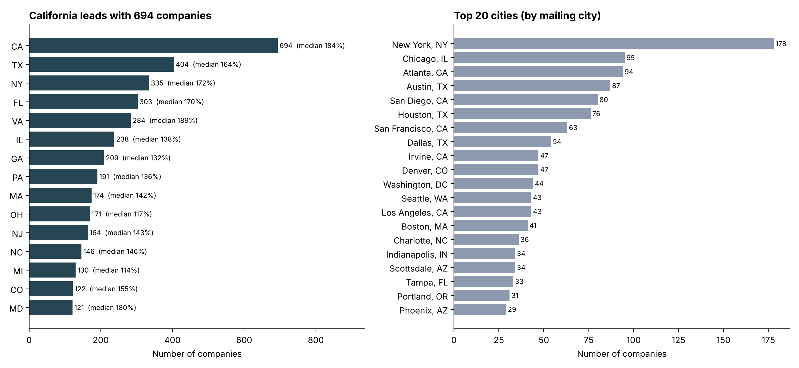
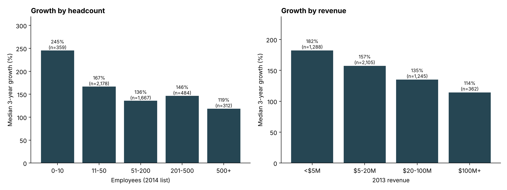

# Inc. 5000 (2014), Five Years Later: Is Fast Growth a One-Time Burst?

A Python and Jupyter analysis of all **5,000 companies** on the 2014 Inc. 5000 (the fastest-growing private U.S. companies, ranked by revenue growth from 2010 to 2013). It then follows them to the **2019 list** to see which companies kept growing.

📓 **[Open the notebook](notebooks/inc5000_2014_analysis.ipynb)**. It runs top to bottom, and GitHub displays it with every chart and table.



## Business question

A company that grew fast once is interesting. A company that **keeps** growing is worth far more to an investor, lender, sales team or job seeker. This project asks:

1. Where were the 2014 fast growers?
2. **Which of them were still on the list five years later, and what predicted it?**
3. How did the list itself change between 2014 and 2019?

## Key findings

1. **Only 489 of the 5,000 companies (9.8%) were back on the list in 2019.** Fast growth rarely repeats.
2. **The most extreme growers returned least often:** 6.8% of the Top 500, versus 10.1% for the rest (p = 0.022).
3. **Track record matters more than one big spike.** Each earlier appearance on the list raised the odds of returning by about 10%, while a company 10× larger had 28% lower odds (both p = 0.001). Once those are accounted for, the 2014 growth rate itself didn't predict a return.
4. **Industry matters most** (p < 0.001):
   - Logistics & Transportation companies returned most often (18%).
   - Retail (2%), Manufacturing (4%) and Energy (4%) rarely returned.
   - **Retail is the sharpest reversal:** it was one of the fastest-growing industries in 2014 (median 215%) but had the lowest return rate.
5. **The companies that came back tripled their revenue** between 2013 and 2018 (median 3.0×, about 24% a year), and their headcount grew 2.4×.
6. **The list's mix shifted between 2014 and 2019.** IT fell from 15% to 9% of companies, while Construction and Software gained the most.
7. **Averages mislead.** The 2014 list's typical company grew 152%, but the average was 516% because Fuhu grew 158,957%. Every comparison here uses medians.





<details><summary>More charts: the 2014 list</summary>






</details>

## Data sources and verification

| File | Source |
|---|---|
| `data/raw/Inc5000 Company List_2014.csv` | The full 2014 list scraped from Inc.'s public list (`inc.com/inc5000list/json/inc5000_2014.json`); the `_`-prefixed columns are scraper metadata |
| `data/raw/INC 5000 Companies 2019.csv` | Public dataset from [Maven Analytics](https://mavenanalytics.io/data-playground/inc-5000-companies) / [Kaggle](https://www.kaggle.com/datasets/mysarahmadbhat/inc-5000-companies), verified in [inc5000-2019-growth-analysis](https://github.com/fritzbriones/inc5000-2019-growth-analysis) |

The 2014 file is checked against figures Inc. and the press published in August 2014:

| Published | This file |
|---|---|
| No. 1 Fuhu: 158,957% growth, $195.6M revenue | ✅ exact |
| No. 2 Quest Nutrition: 57,348% | ✅ exact |
| Nos. 6–11 (Provider Power, Crescendo Bioscience, Plexus, Vacasa, Go Energies, Minute Key) | ✅ growth and revenue match |
| Average growth 516% | 516.4% ✅ |
| Top 500 cut-off 942% | 942.3% ✅ |
| Top 500: median growth 1,828%, revenue $15.2B | 1,827.6%, $15.2B ✅ |
| Minnesota: 94 companies | 94 ✅ |
| Cities: Chicago 95, Atlanta 94, San Diego 80 | ✅ exact |
| Aggregate revenue $211B | $215.3B (2% higher, likely later revisions; every other figure matches) |

**How 2014 and 2019 companies are matched:** by company name with case, spaces and punctuation removed. Each match is then **validated**: a genuine repeat must have more list appearances in 2019 than in 2014. This rejected 7 of 496 name matches, leaving 489.

## What's in the repo

```text
data/raw/                                  original 2014 and 2019 files (unchanged)
notebooks/inc5000_2014_analysis.ipynb      the full analysis
images/                                    charts (written by the notebook)
output/repeat_growers_2014_2019.csv        the 489 repeat companies, with 2014 and 2019 figures
output/repeat_logit_odds_ratios.csv        regression results
output/industry_share_2014_vs_2019.csv, industry_summary_2014.csv, state_summary_2014.csv
archive/tableau/                           the original Tableau workbook and dashboard image
```

## Run it

```bash
pip install -r requirements.txt
jupyter notebook notebooks/inc5000_2014_analysis.ipynb   # then Run All
```

## Limitations

- **Not returning isn't failing.** A company can drop off because it was acquired, went public, stopped applying, was renamed or simply grew less than the cut-off.
- **Name matching misses renamed companies,** so 489 is a lower bound.
- **Repeat companies are selected on success,** so their growth isn't typical of all 2014 companies.
- **The regression explains little of the variation** (pseudo R² 0.006). The factors shift the odds, but most of what decides a return isn't in the data.
- **The Inc. 5000 is not a random sample** of U.S. businesses.
- **Industry labels changed:** 2019 splits IT into three categories, which are combined here for comparison.

## Disclaimer

This is an educational project. All company data, rankings and methodology belong to Inc. This project is not affiliated with, endorsed by or sponsored by Inc. Code is MIT-licensed (see `LICENSE`).
